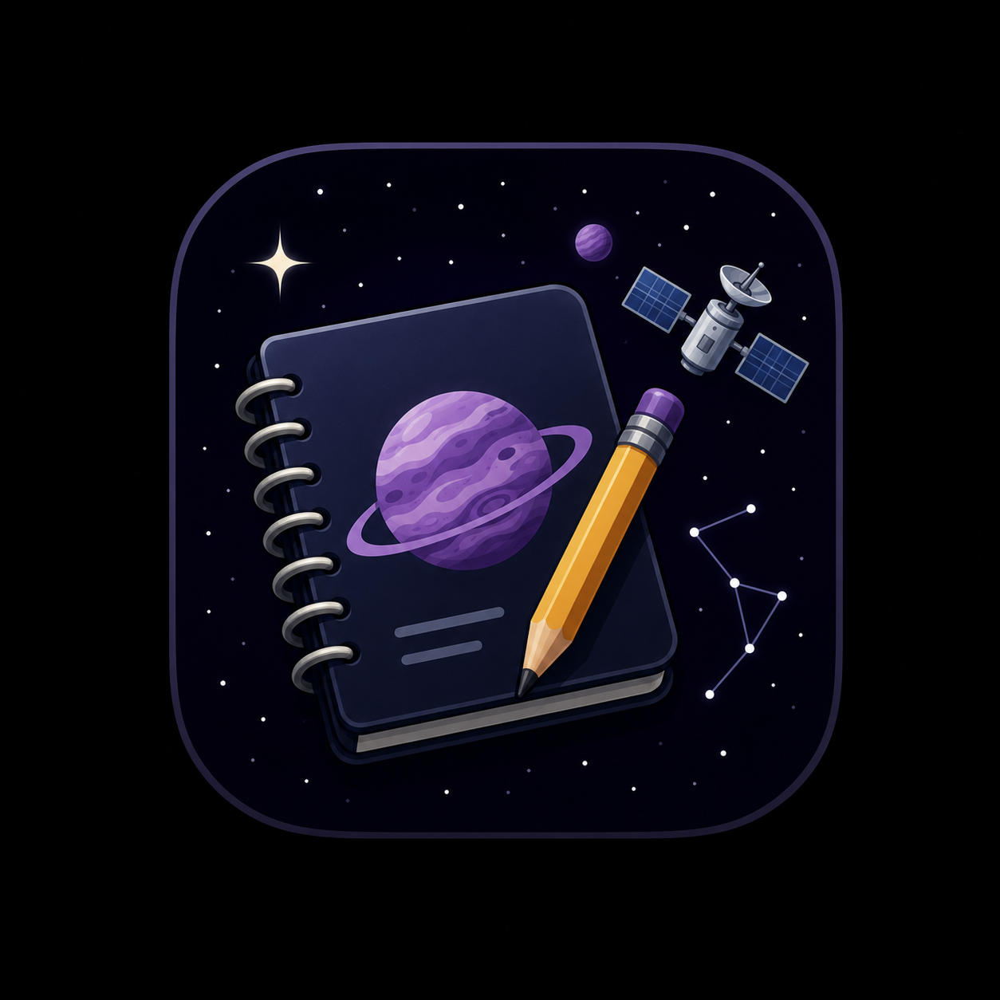
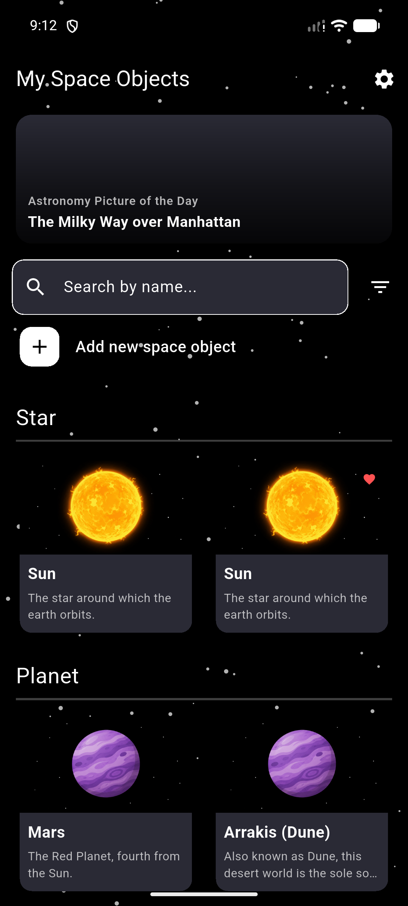
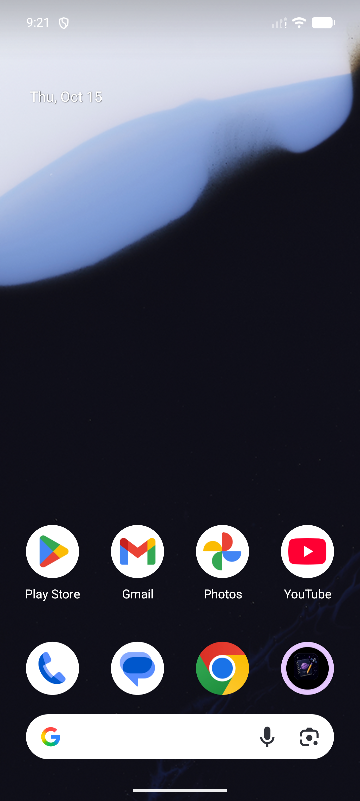
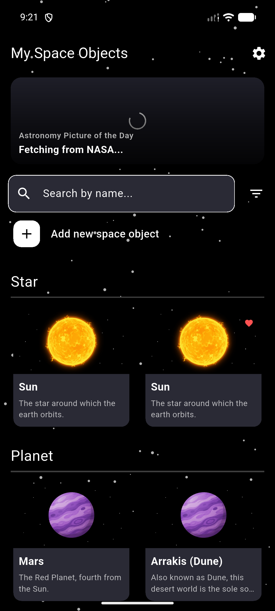
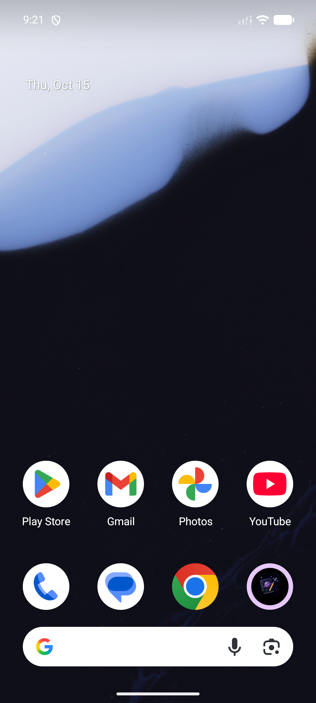
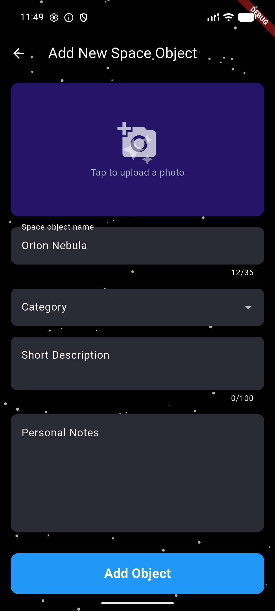
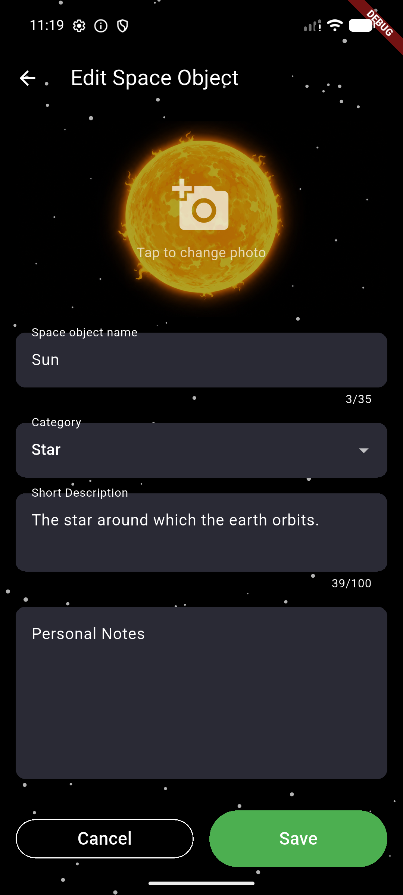
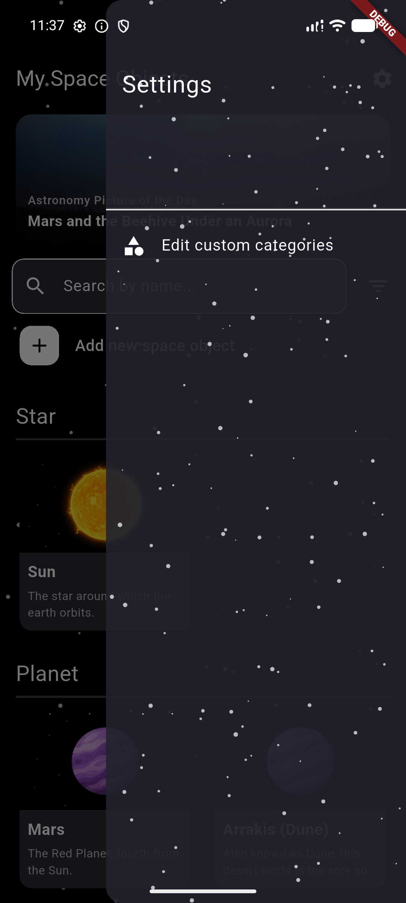
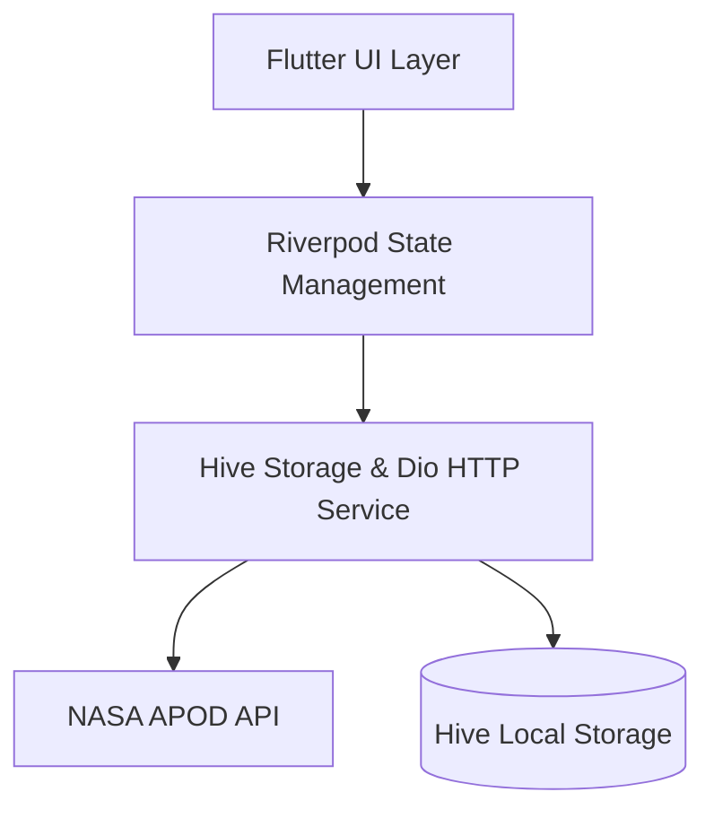

# 🌌 Space Notebook (Space App)

<p align="center">
  
</p>

<p align="center">
  <strong>Your personal astronomical notebook and real-time cosmic guide</strong>
</p>

<p align="center">
  
  
  
  
  
  
</p>

---

## 📖 About the App

**Space Notebook** is a modern, visually immersive mobile application built with **Flutter**, designed for stargazers, astronomy lovers, and night-sky observers. The application combines **daily astronomical content directly from NASA (APOD)** with a comprehensive personal **celestial object journal**, engineered to work seamlessly offline.

The app features a sleek cosmic dark mode with an animated twinkling starfield background, fluid transitions, and a clean Material 3 design.

---

## 📸 Visual Tour (Screenshots)

### 🪐 Home Screen & NASA Astronomy Picture of the Day (APOD)
| Home Screen | Astronomy Picture of the Day (APOD) |
| :---: | :---: |
|  |  |
| *Celestial catalog with favorite badges, APOD banner, and search* | *High-definition imagery, scientific explanation, and one-tap gallery download* |

---

### 🔍 Object Details & Interactive Category Filter
| Celestial Object Detail | Category Filter |
| :---: | :---: |
|  |  |
| *Object visual, favorite heart toggle, description, and notes* | *Fast multi-select category and dedicated Favorites filtering* |

---

### ✏️ Add, Edit & Settings
| Add New Object | Edit Existing Object | Settings Drawer |
| :---: | :---: | :---: |
|  |  |  |
| *Photo upload & input form* | *Update details and notes* | *Custom category management navigation* |

---

## ✨ Key Features

- 🛰️ **NASA Astronomy Picture of the Day (APOD)**:
  - Automatically fetches the latest picture of the day and scientific explanation from the official NASA API.
  - Supports both high-resolution (HD) images and embedded videos.
  - **Offline First**: The latest successfully downloaded photo and explanation are securely cached in a local Hive database, ensuring content remains accessible offline with an informative status badge.
  - 📥 **One-Tap Gallery Download**: Directly save stunning APOD space imagery to your native photo gallery (`Downloads/` fallback) with smooth reactive status feedback (*Download* ➔ *Downloading...* ➔ *Saved*).
  - Supports manual refresh (pull-to-refresh or reload button).

- 🌌 **Celestial Object Catalog & Journal**:
  - Categorized grouping of objects (Stars, Planets, Galaxies, Comets, Black Holes, Moons, Satellites, and custom categories).
  - Every entry includes a title, photo or custom illustration, short overview on the home screen, and comprehensive personal notes.
  - ❤️ **Favorites System**: Instantly mark celestial objects as favorites with an interactive heart toggle in the detail view, visual heart badges on catalog cards, and a top-level Favorites filter with intelligent auto-reset safety.

- 🔎 **Instant Search & Filtering**:
  - Real-time full-text search directly on the home screen.
  - Multi-select category filter dialog with active filter count badge and dedicated Favorites filtering.

- 📝 **Full CRUD Management**:
  - Add new celestial objects with support for uploading images from the device gallery using `image_picker`.
  - Themed icon fallbacks based on category when no custom photo is provided.
  - Edit all fields and safely delete records with a confirmation dialog.

- 🏷️ **Custom Categories**:
  - Add custom categories on the fly while creating an object or through the settings drawer (e.g., *Exoplanet*, *Nebula*, *Space Probe*).
  - Dedicated screen to manage and delete custom categories with duplicate and case-insensitive protection.

- 🧪 **Comprehensive Test Coverage**:
  - Robust test suite with **34 automated unit and widget tests** covering Riverpod providers, UI screen transitions, offline caching, and favorites filtering edge cases.

- ✨ **Premium Cosmic Aesthetics**:
  - Dynamic twinkling starfield with procedurally generated pulsating stars (`StarryBackground`).
  - Cohesive deep-space dark color palette (`AppTheme.darkTheme`).
  - Custom native splash screen (`flutter_native_splash`) with the application icon.

---

## 🛠️ Architecture & Tech Stack



| Component | Technology / Library | Purpose |
| :--- | :--- | :--- |
| **Framework** | [Flutter 3.x](https://flutter.dev) (Dart SDK ^3.11.4) | Cross-platform application development |
| **State Management** | [flutter_riverpod 2.5.1](https://pub.dev/packages/flutter_riverpod) | Reactive state management and dependency injection |
| **Local Database** | [hive 2.2.3](https://pub.dev/packages/hive) & [hive_flutter 1.1.0](https://pub.dev/packages/hive_flutter) | Blazing-fast NoSQL storage for objects and APOD cache |
| **HTTP Client** | [dio 5.9.2](https://pub.dev/packages/dio) | Robust network communication with timeouts and error handling |
| **Media Picker** | [image_picker 1.2.2](https://pub.dev/packages/image_picker) | Photo selection from the device gallery |
| **Configuration** | [flutter_dotenv 6.0.1](https://pub.dev/packages/flutter_dotenv) | Secure environment variable management (`.env`) |
| **Splash & Icons** | `flutter_native_splash`, `flutter_launcher_icons` | Native launch splash screen and app icons |

---

## 📁 Project Structure

```text
space_app/
├── assets/
│   └── images/               # Graphic assets (app_icon, planets, stars, nasa_logo)
├── docs/
│   └── screenshots/          # Application screenshots used in documentation
├── lib/
│   ├── models/               # Data models (SpaceObject with HiveAdapter, ApodItem)
│   ├── providers/            # Riverpod providers (apodProvider, spaceObjectsProvider, categories)
│   ├── services/             # HiveService (box initialization, initial data seeding)
│   ├── ui/
│   │   ├── screens/          # Screens (Notebook, APOD, Add/Edit Object, Categories, Detail)
│   │   └── widgets/          # Reusable components (Banners, dialogs, starfield, cards)
│   ├── utils/                # Themes (AppTheme), constants
│   └── main.dart             # Application entry point
├── pubspec.yaml              # Project dependencies and asset definitions
└── .env                      # Configuration file with API keys
```

---

## 🚀 Getting Started

### Prerequisites
- [Flutter SDK](https://docs.flutter.dev/get-started/install) installed (version 3.x or newer).
- Android Studio / VS Code with the Flutter extension.
- Running Android emulator, connected physical device, or Windows/Web setup.

### 1. Clone the Repository
```bash
git clone https://github.com/karolgrek/spaceApp.git
cd space_app
```

### 2. Install Dependencies
```bash
flutter pub get
```

### 3. Code Generation (for Hive models)
```bash
dart run build_runner build --delete-conflicting-outputs
```

### 4. Run the Application
```bash
# On your default connected device:
flutter run

# Or launch directly on an Android emulator:
flutter run -d emulator-5554

# Or run on Web / Windows desktop:
flutter run -d chrome
flutter run -d windows
```

---

## 💡 Development Tips
- **Hot Reload**: Press `r` in the terminal while running to instantly preview UI and logic changes.
- **Offline Testing**: Toggle Airplane mode in the emulator to inspect APOD offline cache handling and badge indicators.
- **Default Seed Data**: When launching on a fresh database, `HiveService` automatically populates the journal with sample celestial objects (Sun, Mars, Arrakis).

---

<p align="center">
  Built with ❤️ for space enthusiasts everywhere.
</p>
